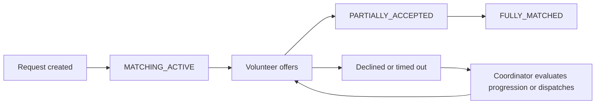
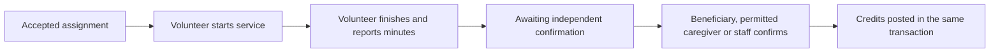

# Time Bank application workflow

This describes the implemented backend and live Flutter app as of 1 November 2026. The public landing page contains
demonstration content. Administrative work happens in the web dashboard; member work happens in Flutter. Preview/demo
mode is separate from the live app.

## 1. Organization setup

A super administrator provisions an organization. Administrators configure its branding, catalogue and staff. A global
service must be active and enabled in the organization before members can request it. Coordinators maintain operational
zones, verify volunteer skills and handle matching exceptions.

## 2. Sign in and join

1. The member enters a phone number and verifies a server-issued OTP.
2. The backend creates or finds their global account and universal time-credit wallet. Flutter loads their profile and
   available active organizations.
3. The member selects an organization and applies as a volunteer, beneficiary or caregiver. Volunteers provide travel
   radius, short-notice availability, usual days/times and claimed skills. Document submission accepts an existing
   storage reference; it does not upload a file.
4. An authorized coordinator/administrator reviews the application and grants an operational role. Requesting a role
   does not grant it automatically. Rejected applicants may reapply; suspended/revoked memberships require staff
   handling.

A person may belong to several organizations and have several approved roles. The current organization determines
permissions and operational records; the universal wallet belongs to the person across organizations.

## 3. Make the role operational

| Role        | Required before the main action                                                                 |
| ----------- | ----------------------------------------------------------------------------------------------- |
| Beneficiary | Approved membership/role and active eligibility, including review date and quota                |
| Caregiver   | Approved role and approved authorization for a specific beneficiary                             |
| Volunteer   | Approved role, availability and any required verified skills; zones/location influence matching |

Caregiver permissions are independent: `canInitiateRequests` allows proxy request creation; `canVerifyCompletions`
allows service confirmation. A verification-only caregiver can open an authorized request from Requests and confirm
finished help, but cannot create requests for that beneficiary. Claimed skills remain pending until verified. Usual
days/times are coordinator information; matching does not currently implement a weekly availability calendar.

## 4. Request assistance

The beneficiary selects an enabled service, or an authorized caregiver selects its recipient. They enter urgency, a
future start time, expected duration, address, ward and PIN code. Location is entered for this request. The backend
checks membership, authority, catalogue, eligibility and quota, then creates the request and initiates matching. Staff
can also create requests on behalf of an eligible beneficiary.

## 5. Match and accept

The backend checks volunteer eligibility, skills, geography and conflicting commitments. Offers have expiry times.
Acceptance reserves an assignment and updates request matching status. A volunteer can decline an offer or withdraw
before starting. A coordinator can dispatch an eligible volunteer and expand or progress matching when needed.

**Operational requirement:** there is no recurring matching scheduler wired into the application. Automatic initial
matching exists, but later offer-expiry/round progression needs an explicit coordinator API/dashboard action. Do not
assume a background task will continually advance unmatched requests.

## 6. Handle a change before service starts

- Cancellation changes the request to `CANCELLED` and cancels open commitments.
- Rescheduling records history, replaces affected commitments with new offers and requires volunteers to accept the
  changed time. Old acceptance IDs are stale.
- Once service starts, cancellation, rescheduling and withdrawal are blocked.
- The backend rechecks permissions and status even if a screen is out of date.

## 7. Deliver and confirm help

Start is allowed from 60 minutes before the scheduled start. Finish records whole minutes and optional notes within
backend limits. An assignment marked `COMPLETED` can still be waiting for confirmation; check `confirmedAt`. A volunteer
can never confirm their own service, including when they also hold a staff role.

The request becomes `COMPLETED` when there are no accepted, in-progress or finished but unconfirmed assignments. Team
requests wait for every outstanding helper. Confirmation and the volunteer's credit payment commit together.

## 8. Credits and donations

The service's configured hourly rate, multiplier and partial-hour policy determine earnings. At the default rate, 40
confirmed minutes earns 0.67 credits. Frozen or inactive-wallet earnings are held instead of becoming spendable. The
ledger is append-only and prevents paying the same assignment twice.

The member can view universal balance/history and give spendable credits to a verified member (organization + membership
number) or approved community pool. Donation transfers write both ledger entries in one transaction; retries with the
same key replay the original transfer. Donors cannot give to themselves, overspend or spend a frozen wallet. Time
credits are separate from loyalty coins.

## 9. Error and session handling

Flutter shows backend errors and does not show successful placeholder operations. Expired access tokens are refreshed;
logout clears the in-memory session. A failed profile load after successful OTP verification can be retried without
verifying that consumed OTP again. Restarting the app requires signing in again because persistent token storage is not
implemented. After connection problems, refresh the affected screen before repeating an uncertain operation.

## Known gaps and review findings

| Priority           | Finding                                                                            | Current handling                                                                              |
| ------------------ | ---------------------------------------------------------------------------------- | --------------------------------------------------------------------------------------------- |
| Fixed              | Confirmation used request-creation permission for caregivers                       | Separate confirmation/view checks; regression includes real PostgreSQL payment                |
| Fixed              | A profile failure after OTP success forced reuse of a consumed OTP                 | Retry profile loading using the authenticated pending session                                 |
| Fixed              | A failed wallet refresh could leave old wallet actions visible                     | Clear wallet/pool data before loading                                                         |
| Production blocker | Production SMS gateway is unimplemented                                            | Development mock OTP only; implement a real gateway before production sign-in                 |
| Workflow gap       | No recurring matching progression worker                                           | Coordinator must evaluate progression/dispatch explicitly                                     |
| Reliability risk   | Request creation persists before matching/audit finish                             | Creation is not one transaction across those steps; inspect a failed creation before retrying |
| Unimplemented      | Binary uploads, offline sync, emergency alerts, merchant redemption, pool spending | Do not present these as live features                                                         |

The request-creation risk is identified from service ordering; failure injection for that path was not added in this
review. It needs separate transactional and retry-recovery work. No claim is made that all possible bugs are eliminated.

## Validation after the follow-up review

- Flutter analysis: no issues; 43 tests passed.
- Backend unit/security/router tests: 459 passed.
- PostgreSQL concurrency/workflow tests: 54 passed, including independent caregiver permissions, request visibility,
  confirmation and payment.
- API TypeScript and lint checks passed.

See [the integration report](FLUTTER_API_INTEGRATION_2026-11-01.md) for the earlier 16 live Dart HTTP checks and
[Flutter live API notes](../apps/mobile/time_bank/LIVE_API.md) for configuration. The nested Flutter repository is
maintained separately and is not included in the parent repository's Git tree.
