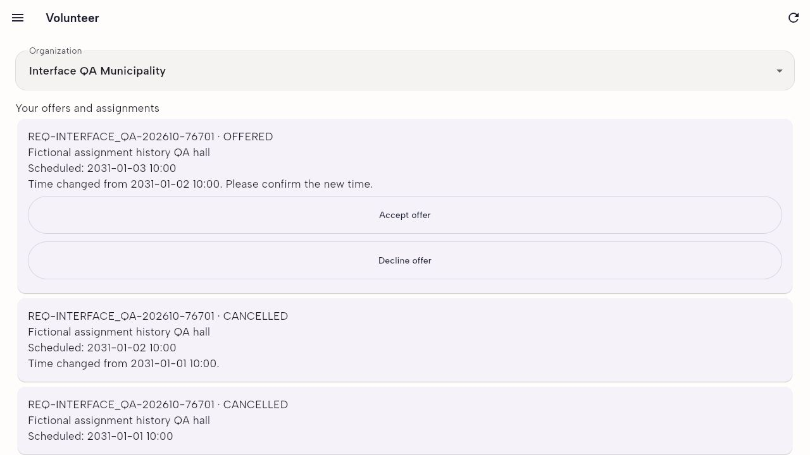

# Assignment history and native Android follow-up

## Historical date fix — 31 October 2026

An old cancelled assignment previously displayed `serviceRequest.scheduledStartTime`, which changes whenever the request
is rescheduled. This made every historical card show the newest date.

The member API and coordinator matching snapshot now return assignment-level `scheduledStartTime`. Linked confirmation
offers use their own reschedule record. Older unlinked assignments use the request's ordered change history and offer
timestamp to recover the offered schedule. The request summary still contains its current date. No migration or stored
records were changed.

The Flutter member cards and coordinator assignment history use the assignment date. Older servers without assignment
dates or reschedule details show historical dates as `Not recorded` rather than presenting the request's current date as
an old commitment.

### Verification

- 331 backend unit/security tests passed, including initial schedules, linked confirmations, multiple changes and legacy
  unlinked assignment history.
- All 35 real PostgreSQL regression/concurrency tests passed. The repeated-reschedule case verifies that member and
  staff views retain the same volunteer's January 1, 2 and 3 dates.
- All 39 Flutter tests passed; Flutter analysis reported no issues.
- Eight live HTTP assertions passed using a disposable database and fictional accounts.
- A rebuilt Flutter browser app displayed January 1 and 2 on cancelled cards and January 3 on the current offer. The
  confirmation dialog still uses the new offer's old/new times.
- API build/lint and dashboard production build passed; all 16 dashboard tests passed.

The live HTTP case is reproducible with `scripts/start-interface-qa.ps1`, followed by
`node scripts/test-assignment-history.cjs`. Its eight assertions and request identifiers are saved under ignored
`node_modules/.cache/interface-qa/assignment-history-verification.json`. Use `scripts/stop-interface-qa.ps1` after
testing.

## Native retry

Gradle 9.1 became available during this retry. The first native build then failed because the required NDK 28.2.13676358
was missing. The installed SDK compatibility wrapper split its semicolon-delimited package identifier into two names.
Google's installed Android CLI successfully downloaded and installed the exact required version using
`ndk/28.2.13676358`. The slash package path follows the
[official Android SDK command documentation](https://developer.android.com/tools/agents/android-cli/commands/sdk). No
project Gradle, Kotlin, Android plugin or NDK version was changed.

The existing Medium_Phone emulator was booted in the background. The prepared integration test uses a fresh disposable
database, the emulator's host address `http://10.0.2.2:3001`, and fixture organization/catalogue/beneficiary IDs. It
tests native OTP login, matching, acceptance, rescheduling, old/new date display, explicit confirmation, stale-offer
rejection, withdrawal, availability, decline, profile/logout, pending membership gating and document references.

Native test execution is tracked below; browser results alone do not establish a native pass.

After the NDK installation, the next native build reached Android resource processing but the Gradle Java process
crashed with insufficient native memory. Its crash report identified an 8 GB maximum heap on this roughly 8 GB host. The
mobile project's `android/gradle.properties` now limits the heap to 2 GB, metaspace to 768 MB, code cache to 128 MB and
Gradle workers to two. Kotlin compilation runs in the build process to avoid another compiler JVM. These settings reduce
peak memory; they do not change app behavior or tool versions. See Gradle's
[JVM memory configuration](https://docs.gradle.org/current/userguide/config_gradle.html).

The native debug APK then compiled successfully. On this host the test emulator was temporarily stopped to free memory
during compilation, then restarted with 1536 MB for the device test run. The intermediate test command therefore
reported the expected missing-device installation error; that attempt establishes a successful APK build, not a native
feature-test pass.

### Final native result

Both native integration flows passed on Medium_Phone (`emulator-5554`). The final run compiled and installed the APK,
then reported `+2: All tests passed!`. This is real Android execution against the local NestJS API and disposable
PostgreSQL database, with no mocked HTTP responses.

The first complete device run passed the pending-member flow but encountered a connection error while saving
availability in the volunteer flow. That update had not reached the database. Test-only transport diagnostics were added
without logging tokens or request bodies; request fixtures were reset and the entire suite rerun. Both flows then
passed, including availability. No production network retry or timeout was changed to conceal the interruption. This
single interruption remains documented as a reliability observation rather than a proven application defect.

`node scripts/verify-native-interface-qa.cjs` then passed eight read-only database assertions: two real requests, two
cancelled old commitments, a reconfirmed/accepted/withdrawn commitment, a declined offer, two reschedules, numeric
radius 3.5, the applicant still APPLIED, and a document reference still pending review. This confirms the native UI
actions persisted on the server.

For a repeat run using the existing disposable fixture IDs, clear request history first with
`node scripts/reset-interface-qa-requests.cjs`; it refuses ordinary database names. Pass the fixture's IDs as `QA_ORG`,
`QA_CATALOGUE` and `QA_BENEFICIARY` Dart defines when running `integration_test/live_api_test.dart` on the emulator. The
mobile source is a separate Git repository under `apps/mobile/time_bank_flutter` and must be reviewed separately.
