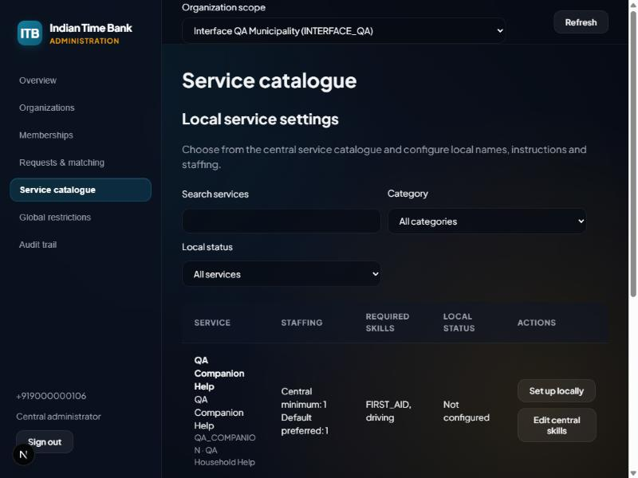

# Service catalogue dashboard

Implemented on 2026-10-31. Nothing was deployed.

## Available workflow

The Service catalogue section lists every central service, including centrally inactive ones, with search, category and
(for a selected organization) local-status filters and client-side paging.

- Coordinators, municipality administrators and super administrators with a selected organization can set up or
  configure a service locally: enablement, minimum and preferred staffing, coordinator-dispatch-only, and English and
  Malayalam local names and instructions.
- Super administrators can edit a service's central skill rule: whether verified skills are required, and the required
  skill codes.

The dashboard validates staffing and skill codes before sending, and the API repeats the same checks:

- Local minimum staffing cannot be below the central minimum; preferred staffing must cover the minimum.
- Required skills need at least one code; at most 50 codes, each 1–50 characters. Codes are trimmed and deduplicated
  without changing case, so they still match verified credentials.
- A centrally inactive service cannot be enabled locally. It can still be disabled or have its text edited.
- Local names are limited to 150 characters and instructions to 5,000.

Changing only enablement keeps the saved staffing, dispatch and label settings instead of resetting them to central
defaults. Request creation and matching already reject disabled local entries; accepted commitments stay recorded.
Central skill and local dispatch-policy changes are included in their audit payloads.

The gateway allows only `GET /catalogue/global`, `PATCH /catalogue/global/:id`, `GET /organizations/:id/catalogue[/:id]`
and `POST /organizations/:id/catalogue/configure`. Other catalogue writes, including proposals, are not forwarded.

Category management, new central service creation, and municipal proposal review have no dashboard screens yet.

## Verification

| Check                                                     | Result                |
| --------------------------------------------------------- | --------------------- |
| API unit/security tests                                   | 334 passed, 29 suites |
| Dashboard session, gateway, date and catalogue-rule tests | 20 passed             |
| API type check and lint                                   | Passed                |
| Dashboard production build, lint and type checks          | Passed                |

The new API tests cover requiring skills without codes, preserving local policy on an enablement-only change, and
refusing to enable a centrally inactive service. The dashboard tests cover the staffing and skill-code rules and the
gateway allowlist.

### Browser run — 31 October 2026

The dashboard was exercised in a browser through the Next.js gateway against the real API and a fresh
`ktb_interface_qa_*` PostgreSQL 18 database from `scripts/start-interface-qa.ps1`, using the fictional coordinator
(+919000000101) and super admin (+919000000106). All of the following passed:

1. Coordinator view: local settings only, no central skill controls. The centrally inactive, unconfigured service had
   its set-up button disabled.
2. Configured QA Household Help with staffing 2/3, coordinator dispatch only and a local English name. The row
   reloaded from the server with those values.
3. Preferred staffing below the minimum kept the dialog open with the validation error, and nothing was saved.
4. Disabling the service kept its staffing, dispatch policy and name. The request screen's create button became
   unavailable. A direct `POST /organizations/:id/requests` through the gateway returned 400: "Selected service is not
   enabled in this organization (D#10)".
5. Re-enabling reopened the dialog with the saved values. A new request then saved with minimum 2 and preferred 3.
   Because the service is dispatch-only, no automatic offers were created: the database had zero volunteer
   assignments and one `MATCHING_SKIPPED_SENSITIVE_SERVICE` audit event.
6. Three `ORG_CATALOGUE_CONFIGURED` audit events recorded enablement, staffing and the dispatch policy.
7. A coordinator calling `PATCH /catalogue/global/:id` directly received 403.
8. The super admin's central view showed only central skill controls. With an organization selected, it showed both
   local and central controls.
9. The dialog rejected "required" with no codes. ` FIRST_AID, FIRST_AID ,  driving ` saved as `FIRST_AID, driving`.
10. Direct API calls with an empty required list, a blank code, or a 51-character code each returned 400.

The temporary API, dashboard and database were stopped and the test cluster removed afterwards.
