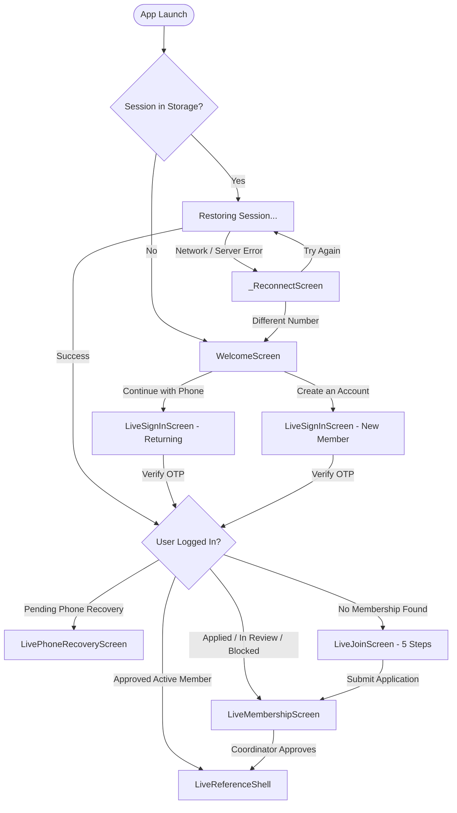
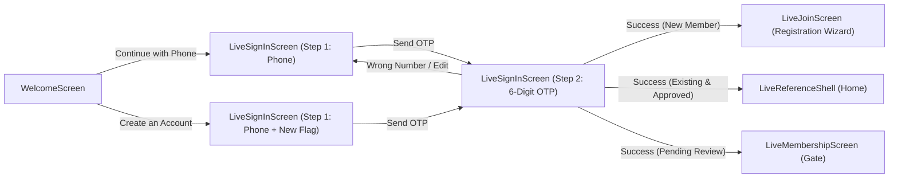
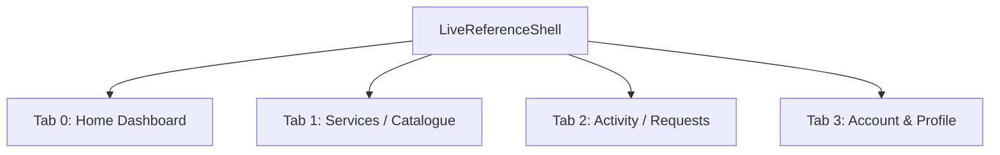
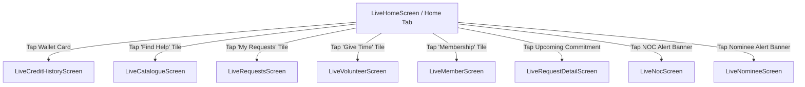
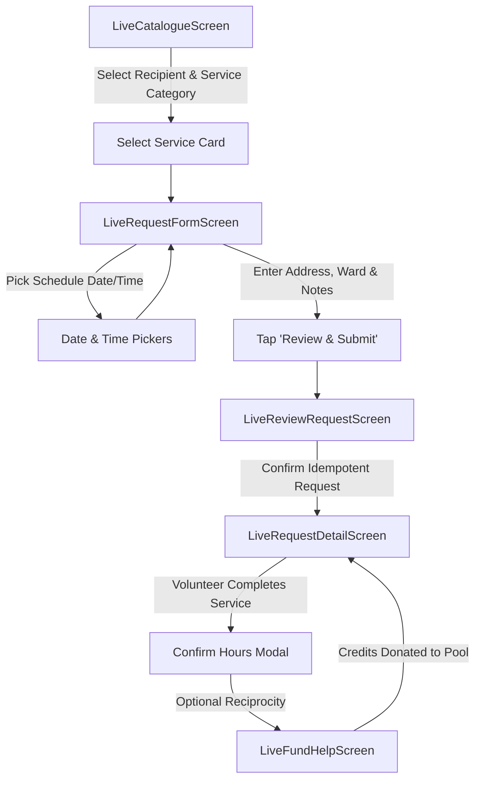
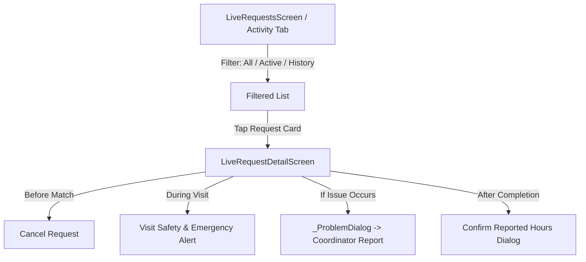
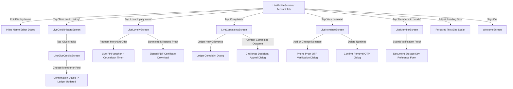
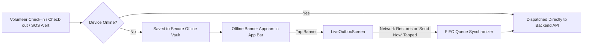

# Application Screen Workflow & Navigation Hierarchy

This document maps out the end-to-end screen transitions, lifecycle checkpoints, navigation flows, and branching logic across the Flutter application (`apps/mobile/time_bank_flutter`).

---

## 1. Top-Level Architectural Flowchart

---

## 2. Phase 1: Entry, Authentication & Onboarding Flow

### Stage Transitions:
1. **App Launch (`LiveApp`):**
   - Reads secure storage (`SecureSessionVault`).
   - If token exists and valid: bypasses welcome flow straight to membership checks.
   - If connection fails during restore: routes to `_ReconnectScreen` with options to retry or switch numbers.
2. **`WelcomeScreen`:**
   - Displays brand animation and value proposition.
   - User chooses between *"Continue with Phone"* (existing account) or *"Create an Account"* (new registrant).
3. **`LiveSignInScreen`:**
   - **Step 1:** User inputs 10-digit Indian phone number (`+91`).
   - **Step 2:** User inputs SMS OTP (or auto-filled dev code).
4. **`LiveJoinScreen` (Wizard):**
   - Traversed if a verified phone has no organization membership yet:
     - **Step 0:** Select Intent (*Volunteer* vs *Request Help*).
     - **Step 1:** Choose Local Community Chapter.
     - **Step 2:** Choose Municipal Ward / Locality.
     - **Step 3:** Preferences, skills, availability, and recipient setup.
     - **Step 4:** Review summary and send application.
5. **`LiveMembershipScreen`:**
   - Shown while the application status is `APPLIED`, `PENDING_REVIEW`, `ORIENTATION`, `REJECTED`, or `SUSPENDED`.
   - Offers real-time *"Check status"* button, coordinator contact details, orientation material, and ward NOC prompts.
   - Once coordinator approves $\rightarrow$ Automatically navigates into `LiveReferenceShell`.

---

## 3. Phase 2: Main Application Shell (`LiveReferenceShell`)

Upon approval, the member enters `LiveReferenceShell`, which hosts a persistent 4-tab bottom navigation bar:

---

## 4. Workflows Accessible from Each Tab

### Tab 0: Home Dashboard Workflow

---

### Tab 1: Service Request & Booking Workflow

---

### Tab 2: Activity & Request Tracking Workflow

---

### Tab 3: Account, Profile & Governance Workflow

---

## 5. Offline & Background Resiliency Workflows

These workflows operate independently across all member screens:

---

## 6. Summary: Complete Screen Order & Priority

| Priority / Stage | Screen Name | Class Name | Triggered By |
|---|---|---|---|
| **0. Error Guard** | Reconnect Screen | `_ReconnectScreen` | Failed session restoration handshake |
| **1. First Launch** | Welcome Screen | `WelcomeScreen` | Cold app launch (no session) |
| **2. Auth Entry** | Sign In / Login Screen | `LiveSignInScreen` | Welcome screen buttons |
| **3. Registration** | Join Community Wizard | `LiveJoinScreen` | First-time user after OTP verification |
| **4. Account Gate** | Membership Status Screen | `LiveMembershipScreen` | Logged in user pending verification/approval |
| **5. Migration Gate** | Phone Recovery Screen | `LivePhoneRecoveryScreen` | Account phone swap initiated by coordinator |
| **6. Main Shell** | Reference Navigation Shell | `LiveReferenceShell` | Approved active member root |
| **7. Dashboard** | Member Home Screen | `LiveHomeScreen` | Shell Tab 0 |
| **8. Discovery** | Service Catalogue Screen | `LiveCatalogueScreen` | Shell Tab 1 or *"Find Help"* tile |
| **9. Booking** | Service Request Form | `LiveRequestFormScreen` | Tapping service from catalogue |
| **10. Booking Review**| Request Review Screen | `LiveReviewRequestScreen` | Submitting booking form |
| **11. Pipeline** | Requests List Screen | `LiveRequestsScreen` | Shell Tab 2 or *"My Requests"* tile |
| **12. Operations** | Request Detail Screen | `LiveRequestDetailScreen` | Tapping any request item card |
| **13. Reciprocity** | Fund Help Screen | `LiveFundHelpScreen` | Voluntary credit gift on completed request |
| **14. Volunteer** | Volunteer Commitments Screen | `LiveVolunteerScreen` | Shell Tab 0 *"Give Time"* tile |
| **15. Wallet** | Credit History Screen | `LiveCreditHistoryScreen` | Tapping balance card on Home or Profile |
| **16. Peer Transfer**| Give Credits Screen | `LiveGiveCreditsScreen` | *"Give credits"* button inside Wallet screen |
| **17. Account** | Profile & Settings Screen | `LiveProfileScreen` | Shell Tab 3 |
| **18. Credential** | Member ID & Documents | `LiveMemberScreen` | *"Membership"* tile on Home or Profile |
| **19. Rewards** | Loyalty & Merchant Coins | `LiveLoyaltyScreen` | *"Local loyalty coins"* tile in Profile |
| **20. Security** | Nominee Management | `LiveNomineeScreen` | *"Your nominee"* tile in Profile or Home alert |
| **21. Governance** | Complaints & Disputes | `LiveComplaintsScreen` | *"Complaints"* tile in Profile |
| **22. Municipal** | Ward NOC Screen | `LiveNocScreen` | NOC alert banner on Home or Membership |
| **23. System** | Offline Outbox Screen | `LiveOutboxScreen` | Tapping offline banner when actions are queued |

